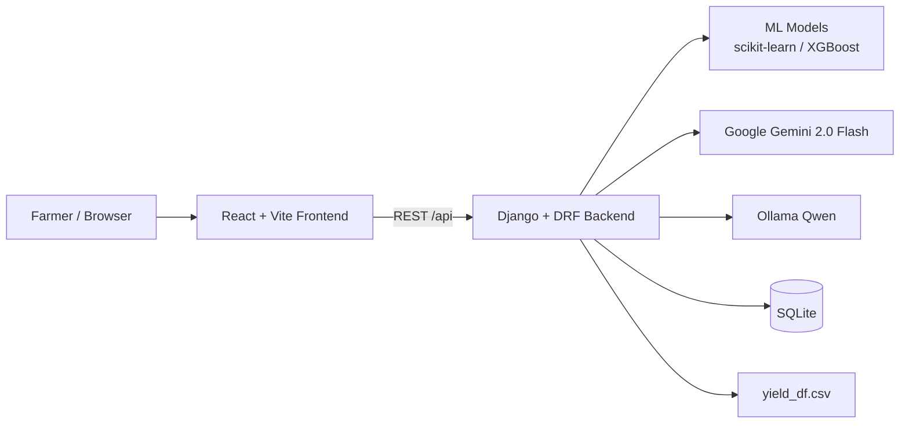

# 🌱 Agro-Agent

<p align="center">
  
</p>

<p align="center">
  <strong>Smart agriculture decision support for crop, fertilizer, and yield planning</strong><br />
  ML predictions · Gemini/Ollama AI guidance · English &amp; Tamil · Docker &amp; Render ready
</p>

<p align="center">
  
  
  
  
  
  
  
</p>

Agro-Agent is an AI-powered agricultural advisory platform that helps farmers and students make data-driven decisions. It combines trained machine-learning models with generative AI to recommend a suitable crop, suggest fertilizer, estimate yield, explain the recommendation, and answer farming questions in **English** and **Tamil**.

## 📚 Table of Contents

- [✨ Key Features](#-key-features)
- [🧱 Tech Stack](#-tech-stack)
- [🏗️ Architecture](#-architecture)
- [🚀 Getting Started](#-getting-started)
- [🔐 Environment Variables](#-environment-variables)
- [🔌 API Endpoints](#-api-endpoints)
- [📁 Project Structure](#-project-structure)
- [🐳 Docker Deployment](#-docker-deployment)
- [☁️ Render Deployment](#-render-deployment)
- [📦 ML Models and Git LFS](#-ml-models-and-git-lfs)
- [🛠️ Troubleshooting](#-troubleshooting)
- [🤝 Contributing](#-contributing)

## ✨ Key Features

- 🌾 **Crop Recommendation** — Predicts the most suitable crop from N, P, K, pH, temperature, humidity, and rainfall using a trained classifier.
- 🧪 **Fertilizer Prediction** — Suggests an appropriate fertilizer based on soil type, crop, moisture, temperature, humidity, and nutrient levels.
- 📈 **Yield Estimation** — Forecasts expected yield in hg/ha from area, crop, year, rainfall, pesticide usage, and temperature.
- 🤖 **AI Prescription** — Generates detailed, explainable farming guidance using Google Gemini 2.0 Flash, with Ollama/Qwen fallback.
- 💬 **AI Chatbot** — Answers practical farming questions through an in-app assistant.
- 🌐 **Bilingual UI** — Full English and Tamil interface with translated recommendations and AI responses.
- 📊 **Historical Yield Trends** — Visualizes historical yield records from `yield_df.csv` by crop, area, and year range.
- 📱 **Responsive Dashboard** — Desktop sidebar and mobile-friendly layout with a modern green agriculture theme.
- 🐳 **Deployment Ready** — Includes Docker, Docker Compose, Nginx, Gunicorn, and Render port configuration.

## 🧱 Tech Stack

| Layer | Technology |
|-------|------------|
| Frontend | React 19, Vite 8, custom responsive CSS, Fetch API |
| Backend | Django 5.2, Django REST Framework, CORS, Gunicorn |
| Machine Learning | Scikit-learn, XGBoost, pandas, NumPy, Joblib |
| Generative AI | Google Gemini 2.0 Flash, Ollama (Qwen) |
| Database | SQLite |
| Deployment | Docker, Docker Compose, Nginx, Render |
| Model Storage | Git LFS for trained `.pkl` model files |

## 🏗️ Architecture



---
## 🚀 Getting Started

### Prerequisites

- Python 3.10+
- Node.js 18+ and npm
- Ollama installed and running locally (for chatbot and AI fallback features)
- Git LFS (for cloning trained model files)

### 1. Backend Setup

```bash
cd backend

# Create and activate a virtual environment
python -m venv .venv
.venv\Scripts\activate          # Windows
# source .venv/bin/activate     # macOS/Linux

# Install dependencies
pip install -r requirements.txt

# Run database migrations
python manage.py migrate

# Start the Django development server
python manage.py runserver
```

The backend starts at **http://localhost:8000**.

### 2. Frontend Setup

Open a new terminal:

```bash
cd frontend

# Install dependencies
npm install

# Start the Vite development server
npm run dev
```

The frontend starts at **http://localhost:5173/** and proxies `/api` requests to the backend.

### 3. Ollama Setup (Chatbot and Fallback)

Make sure Ollama is running, then pull the model used by the app:

```bash
ollama pull qwen
```

Ollama is expected at **http://localhost:11434** by default.

---

## 🔐 Environment Variables

Copy the example file and add your secrets:

```bash
cd backend
cp .env.example .env
```

Edit `backend/.env`:

```env
GEMINI_API_KEY=your_gemini_api_key_here
DJANGO_SECRET_KEY=your_django_secret_key_here
DJANGO_DEBUG=True
DJANGO_ALLOWED_HOSTS=localhost,127.0.0.1
```

- **GEMINI_API_KEY** — Get from [Google AI Studio](https://aistudio.google.com/)
- **DJANGO_SECRET_KEY** — Use a long random value in production
- **DJANGO_DEBUG** — Set to `false` in production
- **DJANGO_ALLOWED_HOSTS** — Comma-separated hostnames for deployment
- **OLLAMA_URL** — Optional override for the Ollama endpoint
- **MODEL_PATH** — Optional override for the directory containing `.pkl` models
- **DJANGO_DB_PATH** — Optional SQLite database path

> **Note:** `.env` is gitignored. Never commit API keys or secrets.

---

## 🔌 API Endpoints

Base URL: `http://localhost:8000/api/`

| Method | Endpoint | Description |
|--------|----------|-------------|
| POST | `/api/recommend/` | Crop, fertilizer, yield, confidence, suitability, and AI prescription |
| POST | `/api/chat/` | Agricultural chatbot response |
| GET | `/api/yield_trend/` | Historical yield records for a crop |

### Example: Recommendation Request

```json
{
  "N": 90,
  "P": 42,
  "K": 43,
  "temperature": 26.5,
  "humidity": 75,
  "ph": 6.5,
  "rainfall": 180,
  "moisture": 40,
  "soil_type": "Loamy",
  "area": "India",
  "year": 2013,
  "pesticides": 12,
  "crop": "rice",
  "language": "en"
}
```

### Example: Chat Request

```json
{
  "message": "Which crop is best for clay soil in high rainfall?",
  "language": "en"
}
```

### Example: Yield Trend Request

```text
GET /api/yield_trend/?crop=rice&area=India&years=1993-2013
```

---

## 📁 Project Structure

```text
agro-agent/
├── backend/
│   ├── agro_backend/          # Django project settings and URLs
│   ├── api/
│   │   ├── views.py           # REST API view logic
│   │   ├── ml_engine.py       # ML prediction functions
│   │   ├── genai_agent.py     # Gemini and Ollama integration
│   │   ├── urls.py            # API routing
│   │   ├── models.py          # Django models
│   │   └── migrations/
│   ├── manage.py
│   ├── requirements.txt
│   ├── Dockerfile
│   ├── .env.example
│   └── .env                   # Gitignored secrets
├── frontend/
│   ├── public/
│   │   ├── favicon.svg
│   │   └── icons.svg
│   ├── src/
│   │   ├── App.jsx            # Main React application
│   │   ├── App.css            # Responsive styling
│   │   ├── main.jsx
│   │   └── assets/
│   │       └── hero.png
│   ├── package.json
│   ├── vite.config.js
│   ├── Dockerfile
│   └── nginx.conf
├── models/                    # Trained ML models tracked with Git LFS
├── datasets/                  # Training and historical datasets
├── ml_notebooks/              # Jupyter notebooks for model training
├── docker-compose.yml
├── .dockerignore
├── .gitattributes
└── README.md
```

---

## 🐳 Docker Deployment

The repository includes a full Docker Compose setup with a Django/Gunicorn backend, React/Vite frontend, Nginx reverse proxy, and a persistent SQLite volume.

From the repository root:

```bash
export GEMINI_API_KEY=your_gemini_api_key_here
export DJANGO_SECRET_KEY=your_django_secret_key_here
docker compose up --build
```

Services:

- Frontend: `http://localhost:8081`
- Backend API: proxied through Nginx at `/api/`
- Ollama: uses `http://host.docker.internal:11434/api/generate` to reach Ollama running on the host

Backend model files are copied from `models/` into the image at `/models`, and SQLite data is stored in the `agroagent_data` volume.

---

## ☁️ Render Deployment

The backend Dockerfile is configured for Render's `PORT` environment variable:

```dockerfile
EXPOSE 10000
CMD ["sh", "-c", "gunicorn agro_backend.wsgi:application --bind 0.0.0.0:${PORT:-10000} --workers 1 --timeout 180"]
```

Recommended Render settings:

- Service type: Web Service
- Runtime: Docker
- Dockerfile path: `backend/Dockerfile`
- Build context: repository root
- Environment variables: `GEMINI_API_KEY`, `DJANGO_SECRET_KEY`, `DJANGO_DEBUG=false`, `DJANGO_ALLOWED_HOSTS=your-render-hostname`
- Persistent disk or managed database if you need durable SQLite storage

The frontend can be deployed as a static site from `frontend/dist` or as the included frontend Docker image.

---

## 📦 ML Models and Git LFS

Trained models are stored with Git LFS:

```bash
git lfs install
git clone https://github.com/Jemimah95434/Agro-Agent.git
cd Agro-Agent
git lfs pull
```

Model files:

| File | Purpose |
|------|---------|
| `crop_model.pkl` | Crop recommendation classifier |
| `fert_model.pkl` | Fertilizer prediction model |
| `yield_model.pkl` | Yield prediction model |
| `le_*.pkl` | Label encoders for soil, crop, fertilizer, area, and item |

If models are missing, check `MODEL_PATH` and ensure Git LFS files were downloaded.

---

## 🛠️ Troubleshooting

- **Model loading errors:** Verify that all `.pkl` files exist and that `MODEL_PATH` points to the `models/` directory.
- **Gemini errors:** Confirm `GEMINI_API_KEY` is valid. The app falls back to Ollama when Gemini is unavailable.
- **Ollama errors:** Ensure Ollama is running and that the `qwen` model has been pulled.
- **CORS errors in development:** Run the Django backend on port `8000` and the Vite frontend on port `5173`.
- **Docker Ollama access:** On Linux, `host.docker.internal` may require additional Docker configuration.
- **Large model clone issues:** Install Git LFS before cloning or run `git lfs pull` after cloning.

---

## 🤝 Contributing

1. Fork the repository.
2. Create a feature branch: `git checkout -b feature/your-feature`
3. Commit your changes: `git commit -m "Add your feature"`
4. Push to the branch: `git push origin feature/your-feature`
5. Open a pull request.

Please keep changes focused, document new environment variables, and update this README when adding features or deployment steps.

---

<p align="center">Built for smarter, data-driven farming 🌾</p>
