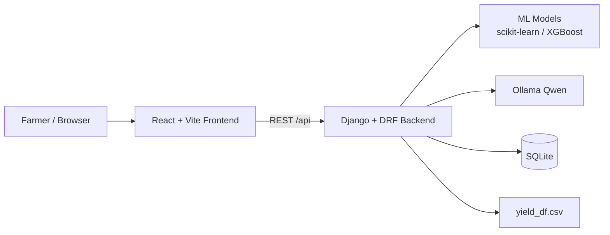
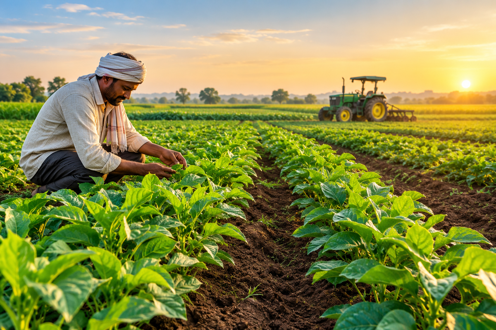
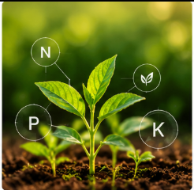
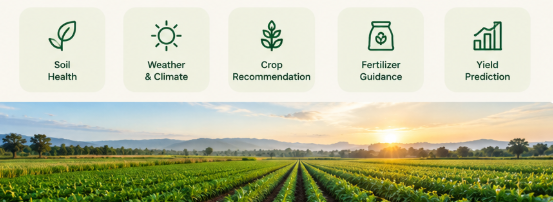

# 🌱 Agro-Agent

<p align="center">
  
</p>

<p align="center">
  <strong>Smart agriculture decision support for crop and fertilizer guidance</strong><br />
  ML predictions · Ollama/Qwen AI guidance · English &amp; Tamil · Docker &amp; Render ready

</p>

<p align="center">
  
  
  
  
  
  
  
</p>

Agro-Agent is an AI-powered agricultural advisory platform that helps farmers and students make data-driven decisions. It combines trained machine-learning models with generative AI to recommend a suitable crop, identify a fertilizer category for a selected crop, explain the results, and answer farming questions in **English** and **Tamil**.

The crop and fertilizer advisors are separate workflows. The fertilizer result is a category only: the bundled data does not support dosage or application-timing advice. Yield is shown as historical dataset records, not as a farm-level forecast. See [ML Models and Limitations](#-ml-models-and-limitations) before using results in the field.

## 📚 Table of Contents

- [✨ Key Features](#-key-features)
- [🧱 Tech Stack](#-tech-stack)
- [🏗️ Architecture](#-architecture)
- [🚀 Getting Started](#-getting-started)
- [🔐 Environment Variables](#-environment-variables)
- [🔌 API Endpoints](#-api-endpoints)
- [📁 Project Structure](#-project-structure)
- [🐳 Docker Deployment](#-docker-deployment)
- [☁️ Render Deployment](#-render-deployment)
- [📦 ML Models and Limitations](#-ml-models-and-limitations)
- [🛠️ Troubleshooting](#-troubleshooting)
- [🤝 Contributing](#-contributing)

## ✨ Key Features

- 🌾 **Crop Recommendation** — Predicts the most suitable crop from N, P, K, pH, temperature, humidity, and rainfall using a trained classifier.
- 🧪 **Fertilizer Advisor** — For a selected crop, returns a fertilizer category from soil type, moisture, temperature, humidity, and NPK values. It does not return dosage or timing.
- 📈 **Yield Insights** — Shows historical yield records from `yield_df.csv` for a crop, area, and year range. These are dataset records, not forecasts.
- 🤖 **AI Crop Explanation** — Generates explainable farming guidance for the crop recommendation through Ollama/Qwen. An optional Gemini helper exists in `genai_agent.py` but is not wired into the REST views.
- 💬 **AI Chatbot** — Answers practical farming questions through an in-app assistant.
- 🌐 **Bilingual UI** — Full English and Tamil interface with translated recommendations and AI responses.
- 📱 **Responsive Dashboard** — Desktop sidebar and mobile-friendly layout with a modern green agriculture theme.
- 🐳 **Deployment Ready** — Includes Docker, Docker Compose, Nginx, Gunicorn, and Render port configuration.

## 🧱 Tech Stack

| Layer | Technology |
|-------|------------|
| Frontend | React 19, Vite 8, custom responsive CSS, Fetch API |
| Backend | Django 5.2, Django REST Framework, CORS, Gunicorn |
| Machine Learning | Scikit-learn, XGBoost, pandas, NumPy, Joblib |
| Generative AI | Ollama (Qwen); optional Gemini helper not used by the current API views |
| Database | SQLite |
| Deployment | Docker, Docker Compose, Nginx, Render |
| Model Storage | Git LFS for trained `.pkl` model files |

## 🏗️ Architecture



---
## 🚀 Getting Started

### Prerequisites

- Python 3.10+
- Node.js 18+ and npm
- Ollama installed and running locally (for crop explanations and the chatbot)
- Git LFS (for cloning trained model files)

### 1. Backend Setup

```bash
cd backend

# Create and activate a virtual environment
python -m venv .venv
.venv\Scripts\activate          # Windows
# source .venv/bin/activate     # macOS/Linux

# Install dependencies
pip install -r requirements.txt

# Run database migrations
python manage.py migrate

# Start the Django development server
python manage.py runserver
```

The backend starts at **http://localhost:8000**.

### 2. Frontend Setup

Open a new terminal:

```bash
cd frontend

# Install dependencies
npm install

# Start the Vite development server
npm run dev
```

The frontend starts at **http://localhost:5173/** and proxies `/api` requests to the backend.

### 3. Ollama Setup (Chatbot and Fallback)

Make sure Ollama is running, then pull the model used by the app:

```bash
ollama pull qwen
```

Ollama is expected at **http://localhost:11434** by default.

---

## 🔐 Environment Variables

Copy the example file and add your secrets:

```bash
cd backend
cp .env.example .env
```

Edit `backend/.env`:

```env
GEMINI_API_KEY=your_gemini_api_key_here
DJANGO_SECRET_KEY=your_django_secret_key_here
DJANGO_DEBUG=True
DJANGO_ALLOWED_HOSTS=localhost,127.0.0.1
```

- **GEMINI_API_KEY** — Optional. Used only by the standalone `genai_agent.py` helper, not by the current REST views.
- **DJANGO_SECRET_KEY** — Use a long random value in production
- **DJANGO_DEBUG** — Set to `false` in production
- **DJANGO_ALLOWED_HOSTS** — Comma-separated hostnames for deployment
- **OLLAMA_URL** — Optional override for the Ollama endpoint
- **OLLAMA_MODEL** — Optional Ollama model name; defaults to `qwen:latest` in the API views
- **MODEL_PATH** — Optional override for the directory containing `.pkl` models
- **DJANGO_DB_PATH** — Optional SQLite database path

> **Note:** `.env` is gitignored. Never commit API keys or secrets.

---

## 🔌 API Endpoints

Base URL: `http://localhost:8000/api/`

| Method | Endpoint | Description |
|--------|----------|-------------|
| POST | `/api/crop/` | Crop recommendation, confidence, suitability, warnings, and AI explanation |
| POST | `/api/fertilizer/` | Fertilizer category for a selected crop; `supported: false` for unsupported crops |
| POST | `/api/recommend/` | Legacy combined endpoint retained for existing clients |
| POST | `/api/chat/` | Agricultural chatbot response |
| GET | `/api/yield_trend/` | Historical yield records for a crop |

### Example: Crop Recommendation Request

```json
{
  "N": 90,
  "P": 42,
  "K": 43,
  "temperature": 26.5,
  "humidity": 75,
  "ph": 6.5,
  "rainfall": 180,
  "language": "en"
}
```

The response contains `crop`, `confidence`, `suitability`, `explanation`, `warnings`, `fertilizer_supported`, and `caveat`. It does not contain fertilizer or yield predictions.

### Example: Fertilizer Advisor Request

```json
{
  "crop": "rice",
  "N": 20,
  "P": 20,
  "K": 10,
  "temperature": 30,
  "humidity": 60,
  "moisture": 40,
  "soil_type": "Loamy",
  "language": "en"
}
```

The response contains `fertilizer`, `confidence`, `crop_category`, `guidance`, `limitations`, `warnings`, and `data_quality`. It does not contain a dosage or application schedule. For an unsupported crop such as banana, the endpoint returns `supported: false`, `fertilizer: null`, and an explanatory message instead of a misleading prediction.

### Example: Chat Request

```json
{
  "message": "Which crop is best for clay soil in high rainfall?",
  "language": "en"
}
```

### Example: Yield Trend Request

```text
GET /api/yield_trend/?crop=rice&area=India&years=1993-2013
```

---

## 📁 Project Structure

```text
agro-agent/
├── backend/
│   ├── agro_backend/          # Django project settings and URLs
│   ├── api/
│   │   ├── views.py           # REST API view logic
│   │   ├── ml_engine.py       # ML prediction functions
│   │   ├── genai_agent.py     # Gemini and Ollama integration
│   │   ├── urls.py            # API routing
│   │   ├── models.py          # Django models
│   │   └── migrations/
│   ├── manage.py
│   ├── requirements.txt
│   ├── Dockerfile
│   ├── .env.example
│   └── .env                   # Gitignored secrets
├── frontend/
│   ├── public/
│   │   ├── favicon.svg
│   │   └── icons.svg
│   ├── src/
│   │   ├── App.jsx            # Main React application
│   │   ├── App.css            # Responsive styling
│   │   ├── main.jsx
│   │   └── assets/
│   │       └── hero.png
│   ├── package.json
│   ├── vite.config.js
│   ├── Dockerfile
│   └── nginx.conf
├── models/                    # Trained ML models tracked with Git LFS
├── datasets/                  # Training and historical datasets
├── ml_notebooks/              # Jupyter notebooks for model training
├── docker-compose.yml
├── .dockerignore
├── .gitattributes
└── README.md
```

---

## 🐳 Docker Deployment

The repository includes a full Docker Compose setup with a Django/Gunicorn backend, React/Vite frontend, Nginx reverse proxy, and a persistent SQLite volume.

From the repository root:

```bash
export DJANGO_SECRET_KEY=your_django_secret_key_here
docker compose up --build
```

Services:

- Frontend: `http://localhost:8081`
- Backend API: proxied through Nginx at `/api/`
- Ollama: uses `http://host.docker.internal:11434/api/generate` to reach Ollama running on the host

Backend model files are copied from `models/` into the image at `/models`, and SQLite data is stored in the `agroagent_data` volume.

---

## ☁️ Render Deployment

The backend Dockerfile is configured for Render's `PORT` environment variable:

```dockerfile
EXPOSE 10000
CMD ["sh", "-c", "gunicorn agro_backend.wsgi:application --bind 0.0.0.0:${PORT:-10000} --workers 1 --timeout 180"]
```

Recommended Render settings:

- Service type: Web Service
- Runtime: Docker
- Dockerfile path: `backend/Dockerfile`
- Build context: repository root
- Environment variables: `DJANGO_SECRET_KEY`, `DJANGO_DEBUG=false`, `DJANGO_ALLOWED_HOSTS=your-render-hostname`, and optionally `OLLAMA_URL`/`OLLAMA_MODEL` if your deployment can reach Ollama
- Persistent disk or managed database if you need durable SQLite storage

The frontend can be deployed as a static site from `frontend/dist` or as the included frontend Docker image.

---

## 📦 ML Models and Limitations

Trained models are stored with Git LFS:

```bash
git lfs install
git clone https://github.com/Jemimah95434/Agro-Agent.git
cd Agro-Agent
git lfs pull
```

Model files:

| File | Purpose |
|------|---------|
| `crop_model.pkl` | Crop recommendation classifier |
| `fert_model.pkl` | Fertilizer category model |
| `yield_model.pkl` | Historical yield regressor |
| `le_*.pkl` | Label encoders for soil, crop, fertilizer, area, and item |

If models are missing, check `MODEL_PATH` and ensure Git LFS files were downloaded.

### Dataset and evaluation caveats

These caveats are based on the bundled files and the updated training notebook:

- **Crop data** — `Crop_recommendation.csv` has 2,200 rows, exactly 100 per class, with no duplicates or missing values. The environmental values are unique per row, which suggests synthetic benchmark data. Test accuracy and 5-fold CV are both about 99.55%. Treat this as a benchmark result, not proof of field accuracy.
- **Fertilizer data** — `Fertilizer Prediction.csv` has 198 raw rows and 99 duplicates. The label `10/26/2026` appears on 14 rows and is almost certainly an Excel conversion of the fertilizer grade `10-26-26`; the notebook excludes it. After removing it and duplicates, only 92 unique rows remain for 6 classes. Every one of the 75 distinct NPK combinations has a single fertilizer label, so NPK values largely determine the target. The model identifies a matching fertilizer grade; it does not validate an agronomic prescription. No dosage or timing is available.
- **Yield data** — `yield_df.csv` has 28,242 rows, 2,310 exact duplicates, and 15,112 repeated `Area + Item + Year` keys. The many-to-many merge produces cases such as India / Rice, paddy / 2013 where one yield value is paired with 19 different temperatures. A random split gives R² ≈ 0.986, but a deduplicated random split gives ≈ 0.966, an unseen `Area + Item` series split gives ≈ 0.687, and an unseen-country split gives ≈ 0.389. The data is country/area-year level, not farm level, and the model cannot extrapolate beyond 1990–2013. The dashboard therefore shows historical records, not a yield forecast.

Use the updated `ml_notebooks/train_models.ipynb` to reproduce the deduplication, cross-validation, group split, and time split before retraining or deploying new model files.

---

## 🛠️ Troubleshooting

- **Model loading errors:** Verify that all `.pkl` files exist and that `MODEL_PATH` points to the `models/` directory.
- **AI errors:** Confirm Ollama is running and the configured `OLLAMA_MODEL` has been pulled. The current REST views use Ollama; `GEMINI_API_KEY` is only needed if you wire the standalone Gemini helper into the views.
- **Ollama errors:** Ensure Ollama is running and that the `qwen` model has been pulled.
- **CORS errors in development:** Run the Django backend on port `8000` and the Vite frontend on port `5173`.
- **Docker Ollama access:** On Linux, `host.docker.internal` may require additional Docker configuration.
- **Large model clone issues:** Install Git LFS before cloning or run `git lfs pull` after cloning.

---

## 🤝 Contributing

1. Fork the repository.
2. Create a feature branch: `git checkout -b feature/your-feature`
3. Commit your changes: `git commit -m "Add your feature"`
4. Push to the branch: `git push origin feature/your-feature`
5. Open a pull request.

Please keep changes focused, document new environment variables, and update this README when adding features or deployment steps.

---

<p align="center">Built for smarter, data-driven farming 🌾</p>

## 📸 Application Screenshots






